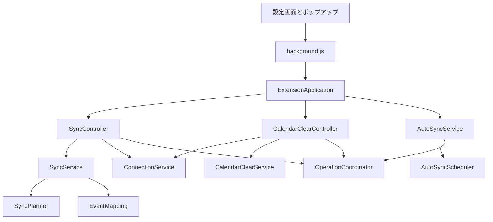

# Chrome拡張機能の設計

保守担当者が、変更する責務と確認すべき不変条件を把握するための設計です。製品の動作は[要件](../requirements/chrome-extension-requirements.md)、実行方法は[開発と検証](../procedures/development-procedures.md)を参照してください。

## 構成と依存方向

`ExtensionApplication`で依存関係を組み立てます。入口のイベント処理へAPI操作と同期判定を置きません。状態を保持する処理はクラスにし、値の変換と日付計算は関数に分けます。

`src`直下にはChromeが読み込む`background.js`だけを置きます。

| フォルダー           | 担当すること                                 |
| -------------------- | -------------------------------------------- |
| `src/config`         | 設定値と入力の検証                           |
| `src/domain`         | 外部サービスに依存しない予定の変換と差分計画 |
| `src/application`    | 外部操作を含むユースケースの実行             |
| `src/infrastructure` | 外部APIの接続とChrome固有の操作              |

テストも境界ごとに分けます。配置と共通環境の考え方は[テスト設計](chrome-extension-tests.md)を参照してください。

| 責務 | 実装 |
| --- | --- |
| Chromeイベントの登録 | [background.js](../../chrome-extension/src/background.js) |
| 初期化と操作の取り次ぎ | [ExtensionApplication](../../chrome-extension/src/application/ExtensionApplication.js) |
| 設定の検証と読み書き | [SettingsService](../../chrome-extension/src/application/SettingsService.js) |
| 同期状態とアイコン | [StatusService](../../chrome-extension/src/application/StatusService.js) |
| 同期の実行と停止要求 | [SyncController](../../chrome-extension/src/application/SyncController.js) |
| 自動同期のON/OFF | [AutoSyncService](../../chrome-extension/src/application/AutoSyncService.js) |
| アラームの更新 | [AutoSyncScheduler](../../chrome-extension/src/application/AutoSyncScheduler.js) |
| 接続先ごとの検証 | [ConnectionService](../../chrome-extension/src/application/ConnectionService.js) |
| 排他と設定更新の順序 | [OperationCoordinator](../../chrome-extension/src/application/OperationCoordinator.js) |
| 全削除ジョブの保存と再開 | [CalendarClearController](../../chrome-extension/src/application/CalendarClearController.js) |
| 削除対象の確認と条件付き削除 | [CalendarClearService](../../chrome-extension/src/application/CalendarClearService.js) |
| 同期計画の適用 | [SyncService](../../chrome-extension/src/application/SyncService.js) |
| 書き込まない差分計画 | [SyncPlanner](../../chrome-extension/src/domain/SyncPlanner.js) |
| 予定の照合と変換 | [EventMapping](../../chrome-extension/src/domain/EventMapping.js) |
| タイムゾーンと日付境界 | [SyncRange](../../chrome-extension/src/domain/SyncRange.js) |
| Garoonタブ内のAPI呼び出し | [GaroonClient](../../chrome-extension/src/infrastructure/GaroonClient.js) |
| Google Calendar APIの通信 | [GoogleCalendarClient](../../chrome-extension/src/infrastructure/GoogleCalendarClient.js) |

## 排他と停止

同期, 接続確認, 全削除のバッチは同時に実行しません。設定更新は別の直列化処理で順番を保つため、同期中でも停止を受け付けます。

全削除の準備では、自動同期を停止して実行中の同期が終了するのを待ちます。全削除の登録と自動同期の再開を同じ設定更新の順序で制御し、削除中に同期が再開する競合を防ぎます。

## 差分計画と適用

`SyncPlanner`は取得済みのGaroon予定とGoogle予定を受け取り、反映計画だけを返します。外部APIやChromeの保存領域へアクセスしません。

`SyncService`は作成と更新を終えてから削除します。カレンダー間の移動でも移動先を先に作るため、中断時に一時的な重複が生じることがあります。次回の計画で移動元を削除します。

作成IDは次の値から決定的に生成します。

- 同期元
- カレンダーID
- Garoon識別子
- 更新日時

全削除を実行したカレンダーには新しい作成世代を保存し、削除済みIDとの衝突を避けます。既存予定との照合に使うGaroon識別子は変更しません。

## 全削除の確認と再開

確認時の予定をIDとETagで固定します。実行前に再取得して値を比較し、同じ内容か検証します。Chromeの保存領域を通すと辞書のキー順が変わるため、JSON文字列の一致を内容一致の条件にしません。

削除時は`If-Match`でETagを照合します。更新された予定を無条件に削除しません。[Googleの変更検出仕様](https://developers.google.com/workspace/calendar/api/guides/version-resources)に従います。

ジョブ本体と処理済みの位置を別に保存し、25件ずつ処理します。各削除後に進捗を保存し、次のアラームかWorkerの再起動後に再開します。全件を処理した後に一覧を再取得し、残件数が0件の場合だけ完了にします。途中で失敗したジョブは自動再試行しません。

## 画面の責務

| 画面の処理 | 実装 |
| --- | --- |
| 設定の読み込みと保存 | [OptionsController](../../chrome-extension/ui/OptionsController.js) |
| タグとカレンダーの行編集 | [CalendarMappingEditor](../../chrome-extension/ui/CalendarMappingEditor.js) |
| 全削除のダイアログと通知 | [CalendarClearView](../../chrome-extension/ui/CalendarClearView.js) |
| 接続結果の共通表示 | [ConnectionStatus](../../chrome-extension/ui/ConnectionStatus.js) |
| ポップアップの操作 | [PopupController](../../chrome-extension/ui/PopupController.js) |

画面はWorkerへ操作名と入力値を送ります。任意のURLやAPIメソッドを受け付ける汎用の実行口は提供しません。Workerでは送信元が拡張機能内の画面であることも検証します。
