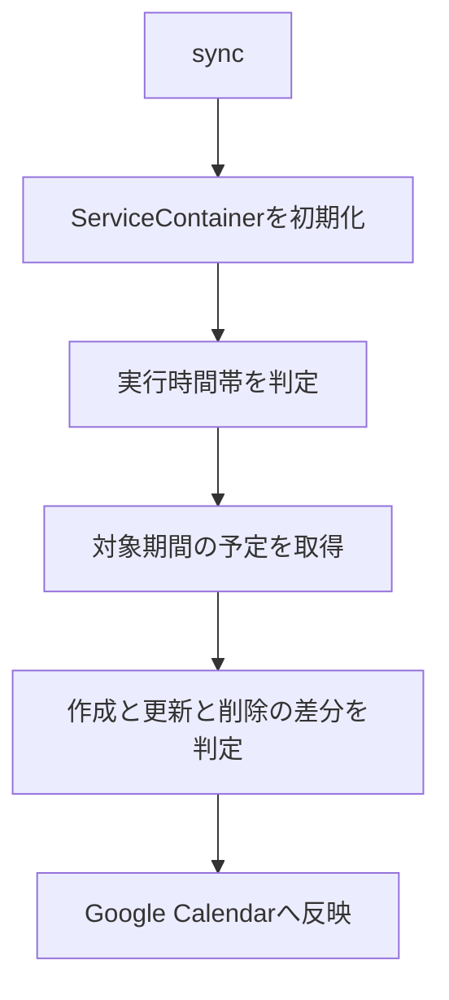

# GAS版の設計

保守担当者がGAS版の変更箇所と依存関係を確認するための設計です。動作の範囲は[要件](../requirements/gas-requirements.md)、配備方法は[準備手順](../procedures/gas-setup.md)を参照してください。

## クラスの責務

| 層 | 責務 | 主な実装 |
| --- | --- | --- |
| 入口 | 初期化して処理を呼び出す | [script.js](../../gas/src/main/script.js) |
| 依存関係の組み立て | 設定とサービスを生成する | [ServiceContainer](../../gas/src/container/ServiceContainer.js) |
| 設定 | ScriptPropertiesの取得と定数管理 | [ConfigManager](../../gas/src/config/ConfigManager.js), [Constants](../../gas/src/config/Constants.js) |
| API接続 | 認証ヘッダーとGaroonのURLを組み立てる | [GaroonApiService](../../gas/src/service/GaroonApiService.js) |
| 外部操作 | GaroonとGoogle Calendarへアクセスする | [GaroonDao](../../gas/src/dao/GaroonDao.js), [GCalDao](../../gas/src/dao/GCalDao.js) |
| エラー処理 | 再試行とログを共通化する | [BaseDao](../../gas/src/dao/BaseDao.js) |
| 同期 | 差分の作成と適用を行う | [SyncEventService](../../gas/src/service/SyncEventService.js) |
| タグ | メモから振り分け先と除外を判断する | [TagParser](../../gas/src/service/TagParser.js) |
| 予定の変換 | タイトルと日時、管理タグを扱う | [GaroonEventService](../../gas/src/service/ScheduleEventService/GaroonEventService.js), [GCalEventService](../../gas/src/service/ScheduleEventService/GCalEventService.js) |
| 値の保持 | 期間とユーザー、カレンダーを表現する | [dataobject](../../gas/src/dataobject/) |

`ServiceContainer`が依存関係を組み立てます。予定サービス間の相互参照は遅延設定のsetterで接続する構造です。通常の変更では、初期化順と未設定時の検証も確認します。

## 同期の流れ



日時と項目の変換は[項目変換](gas-event-mapping.md)へ分離しています。外部APIのパスと実装済みの操作は[Garoon APIとの接続](garoon-api.md)を参照してください。

## 在席情報リセット

`resetPresence()`はGaroon側の依存関係だけを初期化し、`GaroonDao.updatePreference()`へリセット用の値を渡します。

```json
{
    "status": { "code": "" },
    "notes": ""
}
```

送信先は認証ユーザーのプレゼンス更新APIです。指定するユーザーコードは設定と認証情報から決まります。在席ステータスの任意設定を利用者向け機能としては公開していません。
